# Diagrama de classes

```mermaid
classDiagram
    direction LR
    class Usuario { Long id; String nome; String email «único» }
    class Projeto { Long id; String nome «único»; String descricao; String contextoDominio; LocalDateTime dataCriacao }
    class HistoriaUsuario { Long id; String titulo «único no projeto»; String papel; String objetivo; String beneficio; Prioridade prioridade; LocalDateTime criadoEm; LocalDateTime atualizadoEm }
    class Cenario { Long id; String titulo «único na história»; int posicao; OrigemCenario origem }
    class Passo { Long id; TipoPasso tipo; String texto; int posicao }
    class Sugestao { Long id; String ferramenta; String prompt; String conteudo; DecisaoSugestao decisao; MotivoRejeicao motivoRejeicao; String justificativa; LocalDateTime registradoEm; LocalDateTime decididoEm }

    Projeto "1" --> "0..*" HistoriaUsuario : histórias
    HistoriaUsuario "0..*" --> "1" Usuario : autor
    HistoriaUsuario "1" *-- "0..*" Cenario : cenários (ordenados)
    Cenario "1" *-- "1..*" Passo : passos (ordenados)
    HistoriaUsuario "1" *-- "0..*" Sugestao : sugestões
    Sugestao "0..*" --> "1" Usuario : registradaPor
    Sugestao "0..*" --> "0..1" Usuario : decididaPor
```

Enums: `Prioridade {ALTA, MEDIA, BAIXA}`, `TipoPasso {DADO, QUANDO, ENTAO, E, MAS}`,
`OrigemCenario {HUMANO, SUGESTAO_IA}`, `DecisaoSugestao {PENDENTE, ACEITA, REJEITADA}`,
`MotivoRejeicao {INCORRETA, GENERICA, DUPLICADA, FORA_DO_ESCOPO, OUTRO}`.

Losango preenchido = composição (filho removido com o pai, `orphanRemoval`).

## Estratégia de carregamento (LAZY/EAGER)
Todas as associações são **LAZY**: uma tela de lista não precisa dos passos de cada cenário nem das
sugestões. Onde a lista precisa do autor (consulta do projeto, sugestões), o repositório usa
`@EntityGraph` para buscá-lo junto e evitar consultas N+1. As entidades são convertidas em DTO
dentro da transação do serviço (`open-in-view=false`), evitando `LazyInitializationException`.
Contagens de cenários e de sugestões pendentes vêm de duas consultas agregadas por projeto.

## Caminho de "cadastrar um cenário" pelas camadas
SPA (`CenarioEditor`) → `POST /api/historias/{id}/cenarios` com `X-Usuario-Id` →
`HistoriaController` valida o DTO (`@Valid`) → `CenarioService.criar` (identifica o usuário,
exige que seja o autor, verifica título único, aplica `ValidadorCenario`, monta as entidades) →
`CenarioRepository.save` (cascade grava os passos) → `Cenario`/`Passo` (model) → PostgreSQL;
a resposta volta como `CenarioResponse` (201 + `Location`).
